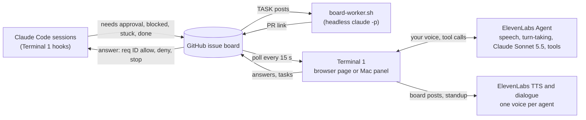

# Terminal 1

**Try it live:** https://40984690-ad84-41e4-86fe-718bb67011bb.mtm.sh (hosted on Maritime)

A voice coworker for people who run several AI coding agents. It watches your agents, speaks up when one needs approval, is blocked, or is stuck retrying a failing command, and you answer by holding a key and talking.


<!-- TODO(operator): record docs/demo.gif, 20 s, no more than 5 MB. Suggested take: a Claude Code session asks to run a command, Terminal 1 speaks, you hold Space and say "show me", then "allow", and the terminal continues. -->

## Connect your agents

This installs the Coworker hooks into your Claude Code settings, so every session posts approvals, blockers, and stuck commands to the board. Needs `gh` logged in and `jq`.

```bash
gh api repos/cherylaurelia/yc-hacky/contents/hooks/install.sh -H "Accept: application/vnd.github.raw" | bash
```

## What it does

- Speaks up when an agent needs approval, is blocked, or is stuck. A stuck alert gives the retry count, the minutes, and an estimated dollar cost.
- The agent that asked talks first, in its own ElevenLabs voice. Then Terminal 1 asks you.
- You answer with your voice. Say allow, deny, stop, or an answer to relay. Hold Space in the browser, or the talk key in the Mac app.
- Say "show me" and the command, file, or diff opens full screen. Terminal 1 never reads a diff aloud.
- Give it a task by voice. A headless Claude Code agent builds it in its own worktree and opens a pull request. That took 34 s on a small change.
- Press Standup and each agent reports its latest news in its own voice.
- Settings sets how often Coworker speaks up on its own: All updates, Blockers only, or Do Not Disturb (for 30 minutes or until you turn it off). Push to talk always works. The same panel picks Coworker's own voice. Agents keep theirs. Both settings are saved in the browser.

A general voice assistant waits for you to ask. Terminal 1 watches your agents and interrupts you.

## How it works



The board is one pinned GitHub issue. A post is a comment that starts with a tag such as `[Sam's Claude]`.

1. The hooks in `hooks/coworker-hook.sh` post to the board when a Claude Code session asks for permission, waits for input, or finishes a long turn.
2. The Terminal 1 page polls the board every 15 s while a voice session is live. One alert is handled at a time, so voices never overlap.
3. The ElevenLabs agent talks to you. Its client tools (`lib/tool-specs.ts`) run on the Next.js server through `app/api/tool/[name]`, except `show_me`, which runs in the browser.
4. Your answer goes back to the board as `req <id> allow`, `deny`, or `stop`. The hook polls the board for that reply every 3 s. It hands Claude Code the decision, or Claude Code shows its normal terminal prompt after `COWORKER_TIMEOUT` seconds or on any error.
5. A post that contains `TASK for Cheryl's Claude:` is a work order. `scripts/board-worker.sh` runs it (see [docs/worker.md](docs/worker.md)).

## Install the hooks

You need `gh` (logged in) and `jq`. Run this once on each machine that runs Claude Code.

```
gh api repos/cherylaurelia/yc-hacky/contents/hooks/install.sh -H 'Accept: application/vnd.github.raw' | bash
```

Restart Claude Code. The installer merges the hooks into `~/.claude/settings.json`, keeps every other hook, saves the original as `settings.json.bak-precoworker`, and can run twice without harm.

- From a clone, `hooks/install.sh --project` installs for that repo only (`.claude/settings.local.json`).
- `hooks/install.sh --uninstall` removes the hooks and restores the saved file.
- Set these in the shell that starts Claude Code. `COWORKER_BOARD` (board issue number, default 1), `COWORKER_REPO`, `COWORKER_NAME`, `COWORKER_TIMEOUT` (seconds to wait for your answer, default 90), `COWORKER_APPROVERS` (GitHub logins whose replies count, default the `gh` user), and `COWORKER_DONE_MIN` (default 60). The header of `hooks/coworker-hook.sh` lists them all.

The hook masks secrets and defuses `@mentions` in what it posts. Only a reply from an approver that names the request id counts.

<!-- TODO(operator): the stuck-loop post (retry count, minutes, dollars), the "req ID stop" handling, and the diff context block are in a hook update that is not on main yet. Confirm that update is merged before you submit, then this install command delivers it. The repo is also private, so `gh api` fails for anyone without read access. Make it public or add the judges. -->

## Run Terminal 1 locally

You need Node 22.18 or newer and a microphone. A browser on `localhost` can use the microphone without https.

1. Clone and install.

   ```
   git clone https://github.com/cherylaurelia/yc-hacky.git
   cd yc-hacky
   npm ci
   ```

2. Create `.env.local` with these variables.

   - `ELEVENLABS_API_KEY` powers the per-agent voices (`/api/speak`) and the standup (`/api/standup`).
   - `GITHUB_TOKEN` reads the repo and the board, and posts your answers. Use the same GitHub account that runs the hooks, or list the token's account in `COWORKER_APPROVERS`.
   - `WRITE_REPOS` is a comma-separated list of `owner/name` repos the voice may write to. Without it, answers, relays, issues, and comments return 403.
   - `BOARD_ISSUE` is optional. It picks the board issue. The default is the open issue labeled `board`, else issue 1.
   - `OWNER_NAME` is optional. It sets the first name in your relay tag. The default is the first name on your GitHub profile.

3. Start the app.

   ```
   npm run dev
   ```

4. Open `http://localhost:3000/?repo=owner/name`. Add `&board=N` to use a board issue other than the default. Hold Space and talk.

The page starts its session with the agent id in `agent.json`. To create your own ElevenLabs agent and its 12 client tools, set `agent_id` to `""` in `agent.json`, export `ELEVENLABS_API_KEY`, and run `npm run sync-agent`. The script writes the new ids back to `agent.json`. Run it again on an existing agent after pulling a change to the override list, because the Coworker voice picker needs the agent to allow a per-session voice.

<!-- TODO(operator): the own-agent step is read from scripts/sync-agent.ts and was not run, because it writes to your ElevenLabs account. Confirm a stranger can also use the agent in agent.json (public agent, no auth), or keep the step above. -->

### Board worker

To turn a spoken task into a pull request, run the worker from this checkout. It needs `gh`, `git`, `perl`, `timeout`, `claude`, and `npm`.

```
scripts/board-worker.sh --baseline   # skip tasks already on the board
scripts/board-worker.sh              # poll every 10 s, one task at a time
```

The agent runs with `acceptEdits`, a short list of allowed commands, a $3 budget, and a 240 s limit. [docs/worker.md](docs/worker.md) has the flags and the risks.

## Mac app

The menu-bar app puts Terminal 1 in a floating panel and lets you hold a key from any app.

```
macos/build.sh
open macos/build/Coworker.app
```

The build uses `swiftc` from the Command Line Tools and needs macOS 13.3 or newer. The panel loads the hosted page; use **Set URL...** in the menu to point it at another deployment, for example `http://localhost:3000/?repo=owner/name&embed=1` from `npm run dev`.

- The talk key is fn, or Right Option when Wispr Flow is installed. Change it in the **Talk key** menu. Right Command and Right Control are also available.
- A tap shorter than 150 ms, or a key combination, cancels the turn.
- macOS asks for microphone access. Use **Grant keyboard access...** to allow the global key listener.
- The panel keeps speaking when you hide it.

## Tests

```
hooks/test.sh
node --test lib/*.test.ts
macos/test.sh
```

`hooks/test.sh` runs the hook against a fake `gh`, with no network. `macos/test.sh` checks the push-to-talk state machine for every talk key.

## Credits

- [ElevenLabs](https://elevenlabs.io) runs the whole voice interface. The Agents platform handles speech in, speech out, turn-taking, and tool calls. Text to speech gives each agent a voice, and text to dialogue records the standup.
- Claude Sonnet 5.5 is the model inside the ElevenLabs agent. Claude Code runs the hooks and the board worker.
- The shared board builds on [azizu06/hackathon-agent-board](https://github.com/azizu06/hackathon-agent-board). `tools/board`, `AGENTS.md`, the issue template, and the session hooks in `.claude/` come from it.
- Built at the YC x ElevenLabs hackathon by Cheryl Aurelia and team.

<!-- TODO(operator): add Codevisor and any other partner tool here only if you used it during the build or the demo. -->
